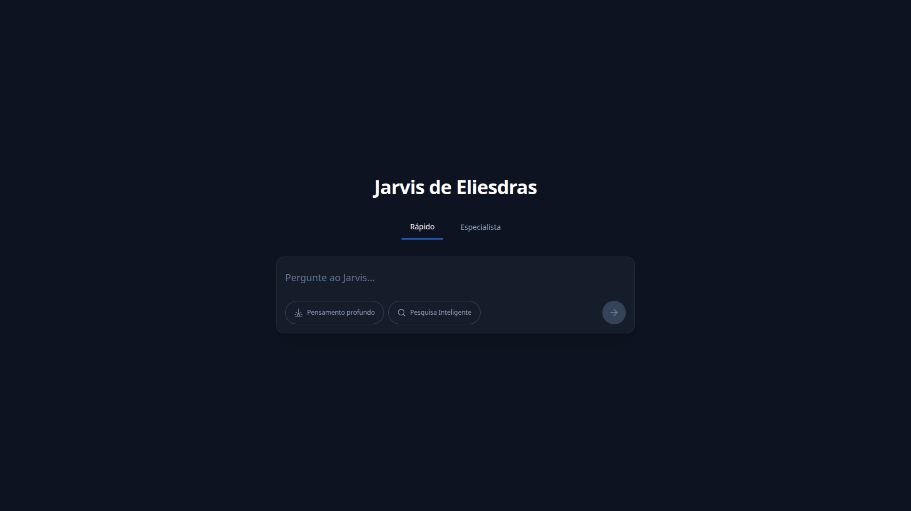

# 🤖 Jarvis de Eliesdras

Interface moderna de chat com Inteligência Artificial — construção de UI com **React 19**, **TypeScript**, **Vite** e **Tailwind CSS v4**.

<p align="left">
  
  
  
  
  
  
</p>

---

## 🚀 Sobre o Projeto

**Jarvis de Eliesdras** é uma interface de chat conversacional inspirada em assistentes de IA modernos. O foco do projeto é demonstrar boas práticas de frontend: arquitetura baseada em componentes, tipagem estática com TypeScript, estilização utilitária com Tailwind CSS v4, experiência de usuário fluida (mobile-first, animações sutis, estado de envio desabilitado) e desempenho com Vite e React 19.

A aplicação permite ao usuário digitar mensagens em um campo de texto auto-ajustável, alternar entre modos de resposta (**Rápido** e **Especialista**) e ativar recursos avançados como **Pensamento Profundo** e **Pesquisa Inteligente** antes de enviar.

> **Nota:** Esta é a camada de frontend (UI). A integração com backend/LLM pode ser adicionada facilmente conectando o handler `handleSend` a uma API real.

---

## 📸 Preview

<p align="center">
  
</p>

_Interface escura, centralizada, com layout responsivo e componentes reutilizáveis._

---

## ✨ Funcionalidades

| Funcionalidade              | Descrição                                                                                                  |
| --------------------------- | ---------------------------------------------------------------------------------------------------------- |
| 💬 **Chat Interface**       | Layout centralizado, tema escuro (`#050b1a`), sombra e bordas sutis para a caixa de mensagens.             |
| 🔀 **Modos de Resposta**    | Alternância entre modo **Rápido** e **Especialista** via abas acessíveis (`role="tab"`).                   |
| 🧠 **Pensamento Profundo**  | Toggle para ativar modo de raciocínio mais aprofundado.                                                    |
| 🔍 **Pesquisa Inteligente** | Toggle para ativar busca contextual inteligente.                                                           |
| 📝 **Texto Auto-ajustável** | Textarea que expande automaticamente conforme o usuário digita (`scrollHeight`).                           |
| ✅ **Estado de Envio**      | Botão "Enviar" desabilitado enquanto o campo estiver vazio, com animação de escala ao clicar.              |
| 📱 **Mobile-First**         | Layout responsivo com media queries (`@media (max-width: 1024px)`), adaptação de espaçamento e tipografia. |
| ♿ **Acessibilidade**       | Labels `aria-label`, `aria-pressed`, `aria-selected` e `role="tablist"` nos componentes interativos.       |
| ⚡ **Performance**          | Build otimizado com Vite, HMR em desenvolvimento, React StrictMode para detecção de efeitos colaterais.    |

---

<table>
  <tr>
    <td><b>Frontend</b></td>
    <td>React 19.3, TypeScript ~7.0.2, Vite 8.3.6</td>
  </tr>
  <tr>
    <td><b>Estilização</b></td>
    <td>Tailwind CSS v4 (via <code>@tailwindcss/vite</code>), CSS customizado</td>
  </tr>
  <tr>
    <td><b>Linting</b></td>
    <td>Oxlint (Oxc-based) com plugins React, TypeScript e Oxc</td>
  </tr>
  <tr>
    <td><b>Build Tool</b></td>
    <td>Vite (dev server HMR + build de produção)</td>
  </tr>
  <tr>
    <td><b>Qualidade de Código</b></td>
    <td>TypeScript strict mode, <code>noUnusedLocals</code>, <code>verbatimModuleSyntax</code>, <code>jsx: react-jsx</code></td>
  </tr>
</table>

### Por que essas tecnologias?

- **React 19**: última versão estável com melhorias de desempenho e novo modelo de hooks.
- **TypeScript**: tipagem estática que reduz bugs em tempo de execução e melhora a manutenibilidade.
- **Vite 8**: servidor de desenvolvimento extremamente rápido e build otimizado para produção.
- **Tailwind CSS v4**: estilização utilitária direto no JSX, integração nativa via plugin do Vite.
- **Oxlint**: linter rápido escrito em Rust (baseado no compilador Oxc).

---

## 📁 Estrutura do Projeto

```text
react-taiwind-chat/
├── public/                 # Arquivos estáticos
├── src/
│   ├── assets/             # Imagens e SVGs
│   ├── components/         # Componentes React (layout, mode, search, ui)
│   ├── App.tsx             # Raiz da aplicação e estado global
│   ├── main.tsx            # Ponto de entrada
│   ├── index.css           # Import do Tailwind
│   └── App.css             # Estilos customizados
├── index.html
├── vite.config.ts
├── tsconfig*.json
├── .oxlintrc.json
└── package.json
```

---

## 🏗️ Decisões de Arquitetura

1. **Separação por responsabilidade**: componentes organizados por domínio (`layout`, `search`, `mode`, `ui`).
2. **Componentes tipados**: todas as props declaradas via interfaces TypeScript.
3. **Estado centralizado no `App.tsx`**: fluxo de dados previsível.
4. **Tailwind utility-first**: classes inline para consistência de design.

---

## 🧩 Componentes Principais

- **`App.tsx`**: gerencia `mode`, `deepThinking`, `smartSearch`, `message` e `handleSend`.
- **`ChatLayout.tsx`**: container centralizado com tema escuro (`bg-[#050b1a]`).
- **`SearchTextarea.tsx`**: auto-ajuste de altura via `scrollHeight`.
- **`SearchControls.tsx`**: agrupa toggles e botão de enviar.

---

## 🏁 Como Executar

```bash
git clone https://github.com/eliesdras/react-taiwind-chat.git
cd react-taiwind-chat
npm install

npm run dev      # servidor de desenvolvimento
npm run build    # build de produção
npm run lint     # linter Oxlint
npm run preview  # pré-visualiza o build
```

---

## 👨‍💻 Autor

Desenvolvido por **Eliesdras**.

---

## 📄 Licença

Este projeto está sob a licença MIT.
